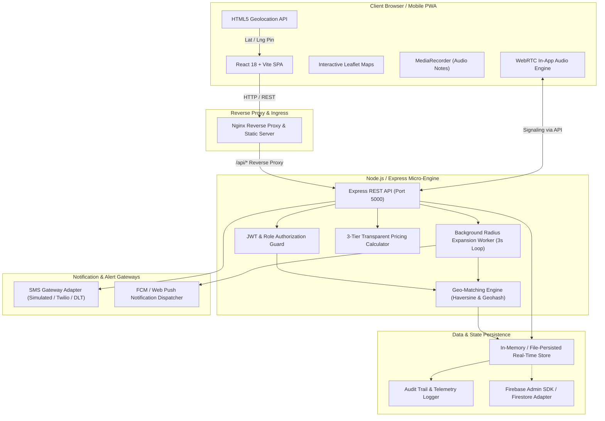
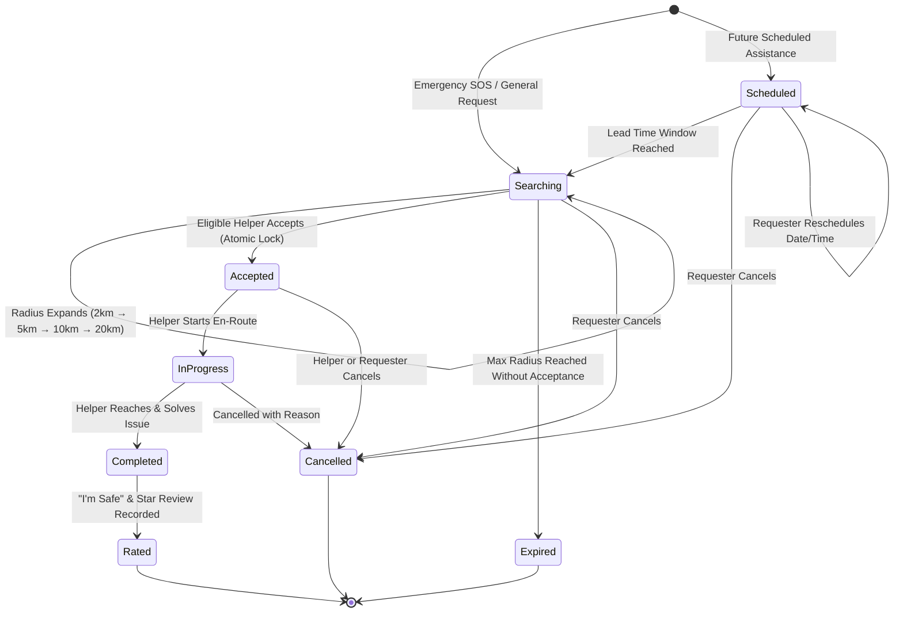

# Help Radius – System Architecture & Specifications

Help Radius is a high-availability, privacy-preserving location-based emergency and community assistance platform connecting individuals in distress with verified first responders and volunteers within dynamic geofenced radiuses.

---

## 1. High-Level System Architecture

---

## 2. Request Lifecycle State Diagram

---

## 3. Why Sensitive Operations Belong on the Backend

1. **Atomic Acceptance (Concurrency Protection):** Multiple nearby helpers may tap "Accept" simultaneously. Only the backend transaction guarantees that exactly one helper wins the request, avoiding race conditions.
2. **Helper Matching & Geo-Filtering:** Exact GPS coordinates of volunteers must remain confidential. The backend filters candidates using Haversine calculation without leaking raw location data to other users.
3. **Emergency Contact Dispatch:** Alerting family contacts via SMS or push must execute reliably on the server even if the user's browser closes or their device battery dies.
4. **Transparent Pricing Integrity:** Rates, free 2-kilometer thresholds, and emergency 100% free exemptions are enforced server-side to prevent manipulation.

---

## 4. Firestore & Data Store Document Schema

- `users/{uid}`: `{ id, name, email, phone, role: 'user'|'admin', isHelper: boolean, permissions: { locationGranted, notificationsGranted }, emergencyContacts: [] }`
- `users/{uid}/emergencyContacts/{id}`: Maximum 6 entries strictly enforced. `{ id, name, phone, relationship, email }`
- `helpers/{uid}`: `{ id, status: 'pending'|'approved'|'rejected', safetyEligible: boolean, isAvailable: boolean, categories: [], rating: number, location: { lat, lng }, verification: { simulatedIdType, notes } }`
- `requests/{id}`: `{ id, type: 'emergency'|'general'|'scheduled', category, priority, status, requesterId, location, radius: { currentKm, stepIndex, history: [] }, acceptedHelperId, voluntaryReward, finalPricing }`
- `chats/{requestId}`: `{ id, participants: [requesterId, helperId], active: boolean, lastMessage, lastMessageAt }`
- `chats/{requestId}/messages/{messageId}`: `{ id, senderId, senderName, type: 'text'|'image'|'audio'|'system', text, media, createdAt, deliveredTo, readBy }`
- `trackingSessions/{requestId}`: `{ requestId, requesterId, helperId, active: boolean, helperLocation, requesterLocation, distanceKm, etaMinutes }`
- `calls/{requestId}`: WebRTC signaling session `{ id, callerId, calleeId, status: 'ringing'|'connected'|'ended', offer, answer }`
- `reports/{id}`: `{ id, reporterId, reportedUserId, reason, status: 'pending'|'resolved' }`
- `adminAudit/{id}`: `{ id, action, actorId, details, timestamp }`
